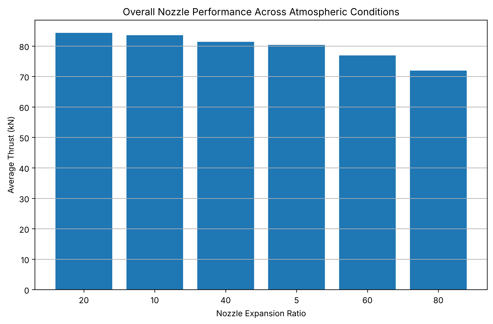
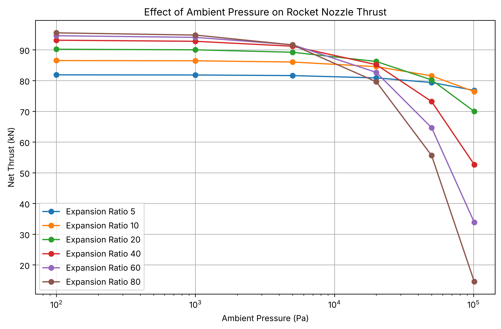
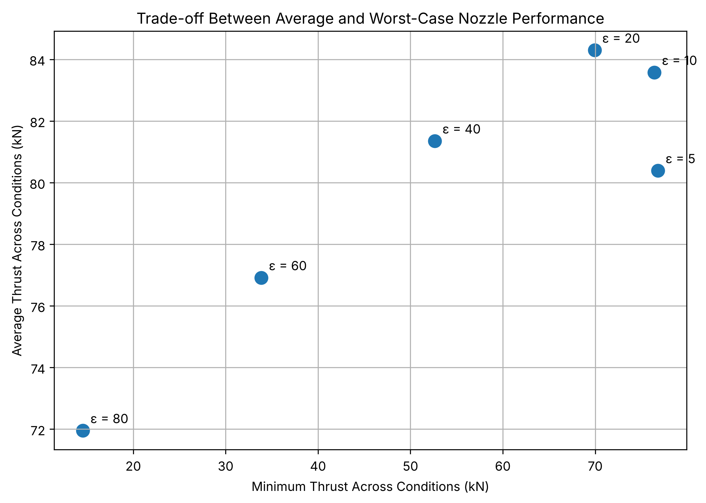

# Rocket Nozzle Expansion Ratio Optimisation

**Computational Optimisation of Rocket Nozzle Expansion Ratios for Maximum Propulsive Performance Across Variable Atmospheric Conditions**

Seshsai Kannan · BS Aerospace Engineering, Amity University Dubai
Nexus 3.0 Student Research Competition (Amity University Dubai × Track 01 · UN SDG 9: Industry, Innovation & Infrastructure

---

## The question

A rocket nozzle has one fixed exit area, but the air pressure around it falls about 1,000× during ascent. So a fixed nozzle is perfectly expanded at only one altitude. **Which single, fixed expansion ratio gives the best performance across the whole climb, from launch pad to vacuum?**

## Key results

| Finding | Result |
|---|---|
| Best overall (highest average thrust across 6 pressures) | **ε = 20 → 84.30 kN** |
| Best at sea level (101.325 kPa) | ε = 5 → 76.80 kN |
| Best near vacuum (0.1 kPa) | ε = 80 → 95.53 kN |
| Pareto-optimal (average vs worst-case thrust) | ε = 5, 10, 20 |
| Worst case: ε 80 at sea level | 92.43 kN momentum − 77.88 kN pressure = **14.55 kN net** |
| Highest average specific impulse | ε = 20 → 293.7 s |

The best-performing expansion ratio climbs with altitude, and the extremes win single conditions but lose overall. Within the tested assumptions, a moderate ratio gives the most balanced performance.







## Method

An idealised **one-dimensional, steady, isentropic, ideal-gas** model of a convergent–divergent nozzle:

1. Choked mass flow at the throat
2. Supersonic exit Mach number from the area–Mach relation, solved with **Brent's method** (`scipy.optimize.brentq`)
3. Exit pressure, temperature and velocity from isentropic relations
4. Thrust `F = ṁ·Vₑ + (Pₑ − Pₐ)·Aₑ` and specific impulse `Isp = F / (ṁ·g₀)`
5. Ranking by average thrust, minimum (worst-case) thrust and Pareto dominance

| Input | Value |
|---|---|
| Chamber pressure | 5 MPa |
| Chamber temperature | 3500 K |
| Specific heat ratio γ | 1.22 |
| Gas constant R | 355 J/(kg·K) |
| Throat area | 0.01 m² |
| Expansion ratios ε | 5, 10, 20, 40, 60, 80 |
| Ambient pressures | 101.325, 50, 20, 5, 1, 0.1 kPa |

6 expansion ratios × 6 pressures = **36 simulation cases**.

## Verification

- **9 built-in validation checks**: choked flow, case count, mass-flow, thrust and Isp consistency, Mach and pressure trends, pressure-thrust trend, and an area–Mach solver accuracy check to 1e-8. All pass.
- **Independent re-implementation** compared case by case: maximum difference ≈ 2.4 × 10⁻¹³ in exit Mach and ≈ 1.5 × 10⁻¹¹ N in thrust.
- **6/6 physical consistency checks** passed.
- **One-at-a-time sensitivity analysis** on chamber pressure (4.5–5.5 MPa), chamber temperature (3150–3850 K) and γ (1.18–1.26). ε = 20 remains the top performer throughout. Chamber temperature has no effect on thrust in this model, because ṁ ∝ 1/√Tc and Vₑ ∝ √Tc cancel.

## Run it

```bash
pip install -r requirements.txt
python nexus.py
```

The run takes a few seconds. It prints all results and validation checks, and saves every CSV, figure and the master Excel workbook to the current folder. It also runs unchanged in Google Colab, where the outputs download automatically. The `results/` folder contains the outputs of a reference run.

## Limitations

This is a theoretical comparison under idealised assumptions. It includes no CFD, shock structures, flow separation, boundary-layer, heat-transfer or real-gas effects. It tests six discrete expansion ratios and weights all six pressures equally. Results for severely overexpanded cases, such as ε = 80 at sea level, are idealised and not predictions of real engine behaviour.

## Future work

- Weight pressures by a real ascent trajectory
- Continuous expansion-ratio sweep
- CFD for shocks and flow separation
- Altitude-compensating nozzles (aerospike, extendable bell)

## Citation

If you use this code, please cite:

> S. Kannan, "Computational Optimisation of Rocket Nozzle Expansion Ratios for Maximum Propulsive Performance Across Variable Atmospheric Conditions," Nexus 3.0 Student Research Competition, Amity University Dubai, Nov. 2026.

## Licence

MIT. See [LICENSE](LICENSE).
